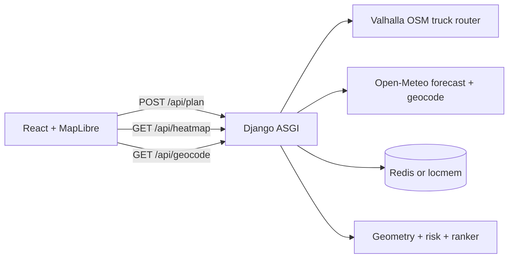

# Architecture

## Request path

1. The trip form posts origin, destination, departure, load, sampling interval, and gust-aware flag.
2. `plan_trip` asks Valhalla for a truck route plus two alternates. Weight is converted to tonnes. Departure time is not sent, because Valhalla drops alternates when `date_time` is set.
3. Each route shape is decoded as a Google polyline (precision 6). Segment lengths and prefix sums produce checkpoints every 10, 25, or 50 miles, with the destination always included.
4. Weather is Redis-first: hourly rows are cached ~6h (fresh for 45m). Fresh hits skip the network; stale hits return immediately and refresh in the background. Open-Meteo **429** opens a circuit and falls back to NWS (`api.weather.gov`) for CONUS cells. Plan and heatmap share the same +48h cell keys.
5. Weather is interpolated to each checkpoint ETA. Risk uses wind / rain / snow thresholds plus load rules. Gust-aware scoring takes `max(wind, gust)`.
6. Routes are ranked lexicographically: any No Travel miles, then severe miles, high miles, average risk, then duration.
7. The plan is cached under `plan:{id}`. The heatmap endpoint rebuilds a corridor grid within 25 miles of every path, scores each cell for hours 0–48, and returns `h0…hN` values the map can swap without refetching.

## Frontend

- TanStack Query owns plan mutation and heatmap query. A new plan aborts the in-flight request.
- Zustand keeps the selected route, focused checkpoint, forecast hour, and play state.
- MapLibre draws one `lineMetrics` source per route so `line-gradient` can follow checkpoint risk. Heatmap weight is a paint property keyed by hour. The truck marker interpolates checkpoint ETAs.

## Hosting

| Piece    | Host   | Notes                                                                 |
| -------- | ------ | --------------------------------------------------------------------- |
| Frontend | Vercel | Project root `frontend/`. Set `VITE_API_URL` to the Render API origin. |
| API      | Render | Docker image, gunicorn + Uvicorn workers, health check `/api/health`. |
| Cache    | Render | Key Value (Redis) required in production. LocMem only for local debug/tests. |
